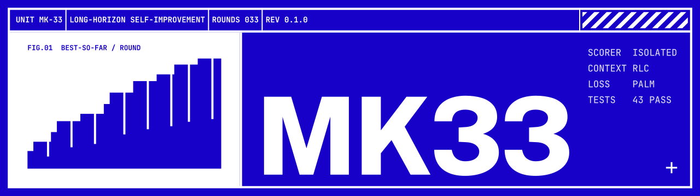
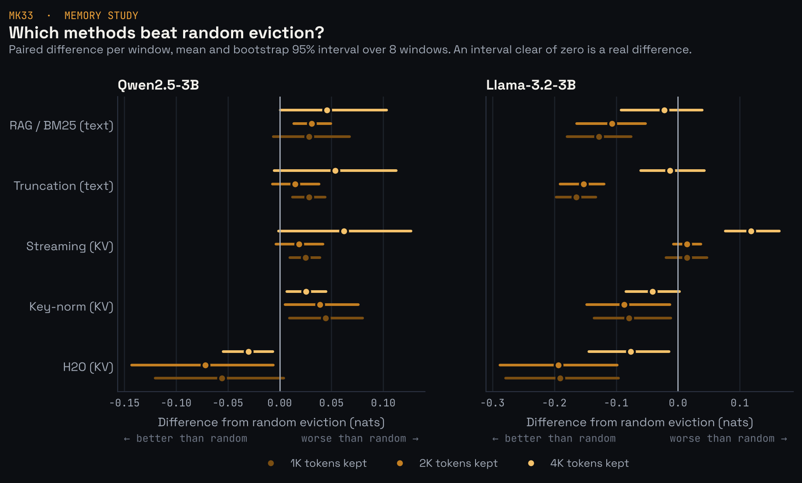

<p align="center">
  
</p>

<p align="center">
  <a href="https://github.com/dulguuntsatsralt-cell/Mk33/actions/workflows/mk33-tests.yml"></a>
  <a href="LICENSE"></a>
  
  <a href="paper/main.pdf"></a>
  <a href="https://colab.research.google.com/github/dulguuntsatsralt-cell/Mk33/blob/main/notebooks/mk33_rag_vs_kv.ipynb"></a>
</p>

Training recipe and reference code for agents that improve their own solutions over many hours.

**Paper:** [Mk33: A Fully Specified Recipe and Reference Implementation for Training Long-Horizon Self-Improving Agents](paper/main.pdf) · [Dulguun Enkhtsatsral](https://dulguuntsatsralt.github.io), 2026

> **Status.** Research code. The pipeline, scaffold, and loss masking are implemented and tested on Linux, macOS
> and Windows. The full-scale recipe has not been run, and the small-scale training experiment
> ([below](#first-trained-model-palm-vs-uniform-masking)) is ready to run but has no results yet. The values in
> `configs/mk33/default.yaml` are proposed defaults, not tuned ones. The small benchmark below runs today on a
> laptop with any OpenAI-compatible model, including a local one.

---

## Overview

[AREX-2](https://arxiv.org/abs/2609.38288) showed that an agent trained on long improvement trajectories keeps getting
better as it is given more rounds. Its paper describes the training recipe in prose and its repository releases only
evaluation code. Mk33 turns that recipe into something you can run and test: every step is code, every
threshold is a config value, and every design choice has an ablation.

It adds four things:

1. **Environment checks.** Scores are put on a common scale, environments without real headroom are dropped,
   training tasks that overlap the test benchmarks are removed, and the scorer is isolated so the agent cannot game it.
2. **Round Ledger Compaction (RLC).** A structured record of every round, failures included, that replaces old
   turns when a multi-hour run fills the context window.
3. **Progress-Aware Loss Masking (PALM).** Exact rules for which agent turns are trained on: none for repeated, empty,
   or polling turns, full weight for turns that led to a better score.
4. **Matching training and test contexts.** The agent and the training data builder share one context builder, so the
   model trains on exactly what it will see at run time. A test checks this.

## How it works

```text
environments ──► filter + decontaminate ──► teacher rollouts (with RLC) ──► audit ──► select
                                                                                         │
             trained agent ◄── weighted SFT ◄── training windows ◄── PALM weights ◄──────┘
```

| Stage | Command | Code |
| --- | --- | --- |
| Keep environments with real headroom; drop benchmark overlap | `mk33 filter` | `src/mk33/envs/` |
| Run the teacher agent with the fixed tool set and RLC | `mk33 rollout` | `src/mk33/scaffold/` |
| Check runs for scorer access, leaked answers, copied solutions | `mk33 audit` | `src/mk33/envs/audit.py` |
| Keep runs that reached the threshold and actually iterated | `mk33 select` | `src/mk33/selection/` |
| Weight each turn by whether it made progress | `mk33 weights` | `src/mk33/palm/` |
| Replay runs into training windows | `mk33 build-sft` | `src/mk33/train/windows.py` |
| Fine-tune with the weighted loss | `mk33 train` | `src/mk33/train/sft.py` |
| Measure productive rounds, gain per round, recovery | `mk33 metrics` | `src/mk33/metrics/` |

## Quick start

```bash
python3 -m venv .venv && source .venv/bin/activate
pip install -e '.[mk33,dev]'
python -m pytest tests/mk33 -q          # unit tests + an end-to-end run on a toy environment
```

For training, also install `.[mk33-train]` (torch, transformers, deepspeed). The full data pipeline is in
`scripts/mk33/run_pipeline.sh`; it expects environment specs, a benchmark list for decontamination, and an
OpenAI-compatible endpoint for the teacher model.

```bash
TEACHER_MODEL=... TEACHER_BASE_URL=http://teacher/v1 bash scripts/mk33/run_pipeline.sh
torchrun --nproc_per_node 8 -m mk33.cli train --config configs/mk33/default.yaml
```

## Small-scale benchmark (no GPU)

`mk33 bench-*` runs the agent on four small CPU-only environments (regression,
text classification, forecasting, knapsack) with any OpenAI-compatible model, and
reports the process metrics above. Its main use is an inference-time version of
ablation A2: RLC versus truncation at a fixed model, with a context window small enough
that compaction matters. Details: [docs/mk33/BENCH.md](docs/mk33/BENCH.md).

A first pilot run (one model on a free API tier, knapsack only, one pair) is reported in
[BENCH.md](docs/mk33/BENCH.md#pilot-run) and Section 9 of the paper. It checks the pipeline end to end; it is
not evidence for or against RLC.

```bash
mk33 bench-prepare --out bench/envs
mk33 bench-run --model <name> --base-url <url> --out bench/results   # MODEL_API_KEY in env
mk33 bench-report --out bench/results
```

Free API tiers and local models are supported with `--rpm`, `--timeout`, `--max-tokens` and `--no-think`;
see the guide for budgets.

## Memory study: retrieval vs KV-cache compression

When a run outgrows the context window, forgetting can happen in the text (truncate, the
round ledger, or retrieval memory that puts relevant old turns back) or inside the model
(keep the full history and compress the KV cache to a fixed budget). The bench compares
both at an equal memory budget on the same local model. Retrieval works with any model;
KV-cache policies (streaming, key-norm, H2O, random control) run on a local Hugging Face
model, with Triton kernels for the eviction step. Design, commands and status:
[docs/mk33/MEMORY.md](docs/mk33/MEMORY.md).

First results (Tesla T4; Qwen2.5-3B and Llama-3.2-3B; bootstrap 95% intervals): attention-based
eviction (H2O) had the lowest loss in every setting and stayed within 0.05 to 0.07 nats of the full
cache while keeping half the context; BM25 retrieval was never distinguishable from plain truncation on
next-token loss; and key-norm eviction beat random on Llama but lost to it on Qwen. The Triton
key-norm kernel runs at about 80% of the T4's memory bandwidth. Reproduce in Colab:
[`notebooks/`](notebooks/).

<p align="center"></p>

```bash
pip install -e '.[mk33-kv]'
mk33 bench-run --backend hf --model Qwen/Qwen2.5-7B-Instruct --window 8000 \
  --modes rlc,retrieve,kv:full,kv:keynorm,kv:random --out bench/memory
```

## Task success: does memory change what the agent solves?

The memory results above are next-token loss. `notebooks/mk33_task_success.ipynb` runs the agent end to end on a free
Colab T4 with each memory method (`truncate`, `rlc`, `retrieve`, `kv:full`, `kv:h2o`) at an equal 8K budget and
compares final scores with paired bootstrap intervals. The grid takes several Colab sessions; results are saved to
Google Drive and runs resume where they stopped.

## First trained model: PALM vs uniform masking

`notebooks/mk33_train_palm.ipynb` runs ablation A1 at a scale that fits one T4: a teacher solves training versions of
the bench tasks (data seeds 1 to 3), the selected runs train two LoRA students on Qwen2.5-1.5B-Instruct (one with PALM
weights, one with uniform weights, nothing else different), and base, uniform and PALM models are compared on held-out
tasks (seed 0). Configs: `configs/mk33/colab/`. The training path is tested end to end on CPU with a tiny model
(`tests/mk33/test_train_smoke.py`).

```bash
mk33 bench-collect --out teacher_runs --to trajs.jsonl            # teacher data from bench runs
mk33 train --config configs/mk33/colab/palm.yaml                   # LoRA, float16, merged model saved
mk33 bench-compare --runs base=eval/base,palm=eval/palm --mode rlc # paired comparison across models
```

## Web research agent

`web_search` and `web_fetch` work out of the box: DuckDuckGo needs no key, and Tavily or Brave are used when their
API key is set. `web_fetch` refuses localhost and private-network addresses, including after redirects, so a page
cannot steer the agent at services on your machine.

```bash
mk33 ask "Which river flows through Darkhan, Mongolia?" --model mk33-qwen2.5-3b --base-url http://localhost:11434/v1 --window 8000
mk33 rollout ... --web auto      # enable web tools on any environment
```

## Running on a laptop (Windows, macOS, Linux)

No GPU is needed for the agent, the bench, RLC or retrieval memory. On Windows, `scripts/mk33/windows/run_local.ps1`
installs everything, runs a local Qwen2.5-3B through Ollama, and starts a pilot run. Guide:
[docs/mk33/WINDOWS.md](docs/mk33/WINDOWS.md).

## LangChain / LangGraph integration

The round ledger is available as middleware for LangChain's `create_agent` (LangGraph). It compacts only what the
model sees, keeps failed steps on the ledger, needs no extra model calls, and can recall old steps with BM25.

```python
from langchain.agents import create_agent
from mk33.integrations.langgraph import LedgerMiddleware, mk33_web_tools

agent = create_agent(model, tools=mk33_web_tools(), middleware=[LedgerMiddleware(window=8000, retrieve_k=2)])
```

Details and a comparison with `SummarizationMiddleware`: [docs/mk33/LANGGRAPH.md](docs/mk33/LANGGRAPH.md).

## Key defaults

| Setting | Value | Config key |
| --- | --- | --- |
| Headroom filter | reference minus baseline ≥ max(3σ, 5% of reference) | `filter` |
| Decontamination | shared dataset or problem ID, or ≥ 50% 13-gram overlap | `decontam` |
| Context window, compaction trigger | 128K tokens, compact at 75%, keep last 2 rounds | `rlc` |
| PALM weight for other turns | λ = 0.5 | `palm.lam` |
| Acceptance | normalized score ≥ 0.9 (ML) or 0.95 (judge), ≥ 3 rounds, must improve after round 1 | `selection` |
| Training | Qwen3.8-27B, LR 1e-5 cosine, 2 epochs, batch 64 | `sft` |

## Ablations

Each file in `configs/mk33/ablations/` changes one thing; `scripts/mk33/run_ablations.sh` rebuilds the
training data for each.

| ID | Question | Configs |
| --- | --- | --- |
| A1 | Does PALM beat simpler masks? | `A1_mask_all`, `A1_mask_arex`, `A1_mask_llm_judge`, `A1_palm_lambda_{0,025,1}` |
| A2 | Does context compaction matter? | `A2_truncate`, `A2_rlc_test_only` |
| A3 | How strict should acceptance be? | `A3_tau_{07,10}` |
| A4 | Does the headroom filter matter? | `A4_no_filter`, `A4_sigma_only`, `A4_rel_margin_only` |
| A5 | How much does the teacher model matter? | `A5_runner_up_teacher` |
| A6 | How much of the gain is contamination? | `A6_no_decontam` |
| A7 | Do gains come from iterating, or from more training data? | `A7_single_attempt` |
| A8 | Does retrieving old turns add to the ledger? | `A8_rlc_retrieve` |

## Evaluation

The paper's benchmarks (MLE-bench Lite, Frontier-CS, BrowseComp, HLE, GAIA, DeepSearchQA) are run with the
[AREX-2 evaluation harness](https://github.com/VectorSpaceLab/AREX-2), so that scores are directly comparable with
AREX-2. It is maintained by its authors and is not included in this repository.

## Repository layout

```text
src/mk33/          the Mk33 package
src/mk33/bench/    small CPU-only benchmark (environments, runner, report)
src/mk33/kv/       KV-cache compression for local models (policies, Triton kernels, chat client)
src/mk33/web.py    web_search / web_fetch providers (DuckDuckGo, Tavily, Brave)
src/mk33/research.py  question answering with web tools (mk33 ask)
src/mk33/integrations/  LangChain / LangGraph middleware
notebooks/         Colab notebooks that reproduce the GPU results
assets/            logo, banner and social card (assets/make_assets.py rebuilds them)
configs/mk33/      default config, DeepSpeed config, ablations, Colab training configs
scripts/mk33/      pipeline and ablation scripts, Windows setup, LangGraph example
tests/mk33/        unit and end-to-end tests
docs/mk33/         design notes, paper-to-code map, data formats, benchmark guide
paper/             paper source (LaTeX) and PDF
```

## Citation

```bibtex
@misc{enkhtsatsral2026mk33,
  title  = {Mk33: A Fully Specified Recipe and Reference Implementation for Training Long-Horizon Self-Improving Agents},
  author = {Enkhtsatsral, Dulguun},
  year   = {2026},
  note   = {arXiv identifier to be added after submission}
}
```

This work builds directly on AREX-2. If you use it, please also cite:

```bibtex
@article{qian2026arex2,
  title   = {AREX-2: Advancing Self-Improving Agents through Long-Horizon Reflective Tasks},
  author  = {Qian, Hongjin and Li, Chaofan and Luo, Kun and Wei, Wenqing and Chen, Jianlyu and Lu, Shuqi and Hu, Yuyang and Xiao, Hongwang and Wang, Hui and Li, Chaozhuo and Ye, Qiwei and Dou, Zhicheng and Lian, Defu and Liu, Zheng},
  journal = {arXiv preprint arXiv:2609.38288},
  year    = {2026}
}
```

## License

Apache-2.0. See `LICENSE` and `NOTICE`.
