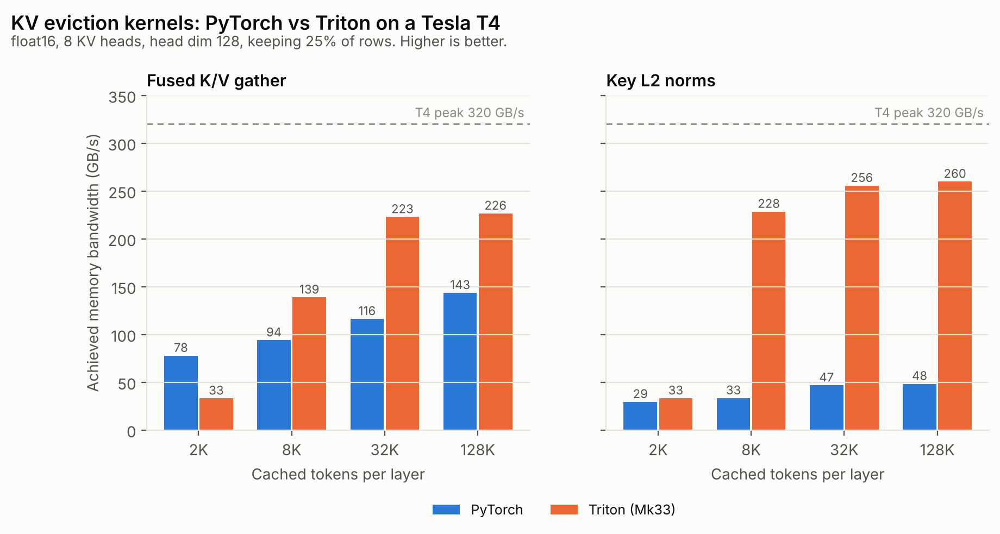
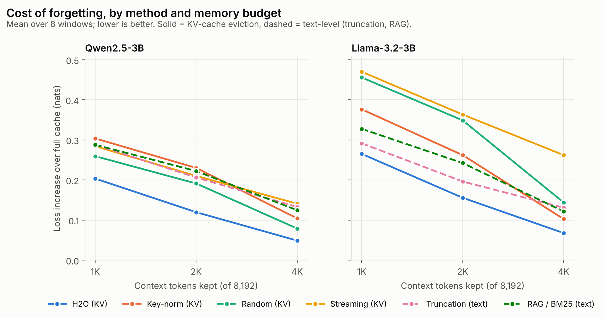
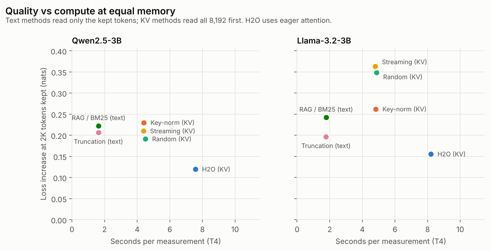

# Memory for long-horizon agents: text-level vs KV-level forgetting

A long improvement run outgrows any context window. Something has to be forgotten,
and there are two places to do it:

- **In the text**, before the model sees it: drop old turns (`truncate`), summarize them
  into a ledger (`rlc`), or move them into a store and retrieve the relevant ones back
  (`retrieve`, `rlc+retrieve`).
- **In the model**, after it has read them: keep the full text history and compress the
  model's KV cache to a fixed budget, choosing which tokens' keys and values to keep
  (`kv:<policy>`).

This study runs both on the same bench, the same model and the same budgets, and asks:
at a fixed memory budget, which kind of forgetting lets an agent keep improving?

## Modes

| Mode | What the model sees | What is forgotten | Needs |
| --- | --- | --- | --- |
| `truncate` | recent turns | oldest turns, silently | any model |
| `rlc` | ledger (one line per round) + recent rounds | details of old rounds | any model |
| `retrieve` | recent turns + top-k old turns by relevance | old turns not retrieved this round | any model |
| `rlc+retrieve` | ledger + recent rounds + top-k old turns | details not retrieved | any model |
| `kv:full` | everything (up to the model's limit) | nothing | local model |
| `kv:streaming` | everything, but the cache keeps sinks + most recent tokens | the middle | local model |
| `kv:keynorm` | everything; cache keeps low-norm keys + sinks + recent | high-norm keys | local model |
| `kv:h2o` | everything; cache keeps most-attended tokens + sinks + recent | rarely attended tokens | local model, eager attention |
| `kv:random` | everything; cache keeps random tokens + sinks + recent | random tokens | local model |

`kv:random` is the control: a policy that does not beat it has not shown it knows which
tokens matter. `kv:full` is the ceiling at unlimited memory.

**Equal-memory comparison.** A text-level mode with `--window W` holds about W tokens in
the model's cache. A kv mode with `--kv-budget B` holds about B. Running both with
`--window 8000 --kv-budget 8000` (the default sets the budget to the window) compares
them at the same cache size, which is the point of the study.

## Retrieval memory (`src/mk33/scaffold/memory.py`)

- **What is stored.** Each turn that leaves the context becomes one item: the agent's
  reasoning, its tool call, and the head and tail of the tool output (where commands
  echo and where scores and tracebacks end up), capped at `--retrieve-item-chars`.
- **Retriever.** BM25 over identifiers and numbers, using only the standard library, so
  CPU runs need nothing extra. `--retriever embed --embed-model <name>` switches to
  dense retrieval through any OpenAI-compatible `/embeddings` endpoint.
- **Query.** The agent's last two turns, so retrieval follows what it is working on now.
- **Budget.** At most `--retrieve-k` items and `--retrieve-budget` tokens. That budget is
  reserved when compacting, so the context still fits the window.
- **Refresh.** The retrieved block sits in the prefix, which Mk33 freezes between events
  so the context only grows by appending. Changing it is therefore an event like a
  compaction: it starts a new training window and invalidates the KV cache for
  everything after the system prompt. With `--retrieve-refresh round` (default) this
  happens at every new round; with `compaction` only when compacting. The trade-off
  (fresher retrieval vs fewer cache invalidations) is measurable with the compaction
  count in the report.
- **Train/test consistency.** Retrieval runs inside `ContextBuilder`, which the training
  replay also uses, so `mk33 build-sft` reproduces the retrieved contexts exactly. The
  tests check this turn by turn, as they already did for `rlc`. Ablation config
  `A8_rlc_retrieve` trains with it.

## KV-cache compression (`src/mk33/kv/`)

- **Where it runs.** `HFChatClient` is a drop-in `ChatClient` for a local Hugging Face
  model. It formats messages and tool schemas with the model's own chat template and
  parses Hermes/Qwen-style `<tool_call>` blocks. With `--backend hf`, every mode in a
  grid (text-level ones too) runs on the same local model.
- **Bounded cache.** The prompt is prefilled in chunks (`--kv-chunk`). After each chunk,
  and every 64 tokens while decoding, the cache is compressed back to the budget. Peak
  cache size is about `budget + chunk` tokens per layer, whatever the prompt length.
- **Positions.** Cached keys already carry their rotary embedding, so evicting rows does
  not disturb them; new tokens get their true positions via `position_ids` while
  `cache_position` indexes the shorter cache. A test checks this exactly: after
  eviction, the next token's logits equal a full forward pass in which that token is
  masked from the evicted ones.
- **Per head.** Each KV head keeps its own set of tokens (same count, different indices).
- **Policies** (`policies.py`): sinks and recent tokens are always kept; the policy fills
  the middle. `keynorm` needs no attention scores; `h2o` accumulates attention
  probabilities over all queries so far, which needs eager attention (slower prefill,
  more memory). `kv_quality.py` and the report show the cost.
- **Triton kernels** (`triton_ops.py`): one fused kernel gathers the kept rows of K and V
  in a single launch with arbitrary input strides; another computes key norms with
  float32 accumulation without a float32 copy of the cache. Both are checked against
  the PyTorch reference (bit-exact for the gather) on GPU or in Triton's CPU
  interpreter. `scripts/mk33/bench_kv_kernels.py` measures time and bandwidth.
- **Simplification.** Each model call prefills its prompt from scratch; there is no
  cache reuse across calls. Prefill time is therefore reported per call, and compression
  is applied as the prompt is read. Cross-call prefix caching under compression is a
  natural next step.

## Running it

On a machine with an NVIDIA GPU (Colab: Runtime > Change runtime type > GPU).

```bash
git clone https://github.com/dulguuntsatsralt-cell/mk33 && cd mk33
pip install -e '.[mk33-kv,dev]'
python -m pytest tests/mk33 -q          # on a GPU this includes the Triton kernel tests

# 1. Kernels: PyTorch vs Triton, time and bandwidth
python scripts/mk33/bench_kv_kernels.py --out bench/kv_kernels.json

# 2. Does the model's tool calling work with HFChatClient?
python scripts/mk33/kv_quality.py --model Qwen/Qwen2.5-7B-Instruct --smoke

# 3. Perplexity vs budget for every policy (minutes, no agent)
python scripts/mk33/kv_quality.py --model Qwen/Qwen2.5-7B-Instruct --context 8192 \
  --budgets 512,1024,2048,4096 --out bench/kv_quality.json

# 4. The agent grid at an equal memory budget (start small to time it)
mk33 bench-prepare --out bench/envs
mk33 bench-run --backend hf --model Qwen/Qwen2.5-7B-Instruct --window 8000 \
  --modes truncate,rlc,retrieve,rlc+retrieve,kv:full,kv:streaming,kv:keynorm,kv:random \
  --tasks knapsack --repeats 1 --out bench/memory
mk33 bench-report --out bench/memory
```

Text-level modes also run against any API model without a GPU:

```bash
mk33 bench-run --model <name> --base-url <url> --modes rlc,truncate,retrieve,rlc+retrieve --out bench/retrieval
```

**Choosing a model and GPU.** Qwen2.5-7B-Instruct in bfloat16 needs about 16 GB plus
cache: an L4 (24 GB) or A100 works. On a T4 (16 GB, no fast bfloat16) use
Qwen2.5-3B-Instruct with `--dtype float16`, keeping in mind that models around 3B often
describe edits instead of calling tools (see BENCH.md). `kv:h2o` uses eager attention;
lower `--kv-chunk` if prefill runs out of memory.

## What to report

1. `bench/memory/report.md`: per mode, best normalized score, best-so-far AUC, peak KV
   cache, evicted share, prefill time; and paired bootstrap intervals for every pair of
   modes. Only call a difference real when its interval excludes zero.
2. `kv_quality.json`: perplexity gap to the full cache as a function of budget, per policy.
3. `kv_kernels.json`: Triton vs PyTorch time and achieved bandwidth on your GPU.

## First results (Tesla T4, Qwen2.5-3B-Instruct, October 2026)

One free Colab T4 session. Raw numbers: [results/t4-qwen2.5-3b/](results/t4-qwen2.5-3b/).
All tests passed on the GPU, including the Triton kernel tests on real hardware.

### Kernels

float16, batch 1, 8 KV heads, head dim 128, keeping 25% of rows. The T4's peak memory
bandwidth is 320 GB/s.

| tokens | gather: PyTorch / Triton (ms) | speedup | Triton GB/s | key norm: PyTorch / Triton (ms) | speedup | Triton GB/s |
| --- | --- | --- | --- | --- | --- | --- |
| 2,048 | 0.054 / 0.128 | 0.43x | 33 | 0.145 / 0.129 | 1.1x | 33 |
| 8,192 | 0.180 / 0.122 | 1.5x | 139 | 0.512 / 0.075 | 6.9x | 228 |
| 32,768 | 0.582 / 0.304 | 1.9x | 223 | 1.459 / 0.267 | 5.5x | 256 |
| 131,072 | 1.886 / 1.195 | 1.6x | 226 | 5.646 / 1.050 | 5.4x | 260 |



- The key-norm kernel reaches about 80% of peak bandwidth and is 5 to 7 times faster
  than `k.float().norm(-1)`, which first writes a float32 copy of the keys.
- The fused gather is 1.5 to 1.9 times faster than two `torch.gather` calls from 8K
  tokens up, at about 70% of peak.
- At 2K tokens both kernels are dominated by a fixed launch cost of about 0.12 ms, and
  the gather is slower than PyTorch. For short caches the PyTorch path is the better
  default; `backend="auto"` does not yet switch on size.

### Perplexity vs cache budget

Next-token loss (NLL, nats) on 1,024 tokens of the paper and scaffold code, given the
8,192 tokens before them. Sinks 4, recent 256. Full cache: NLL 1.641, 324 MB peak.
Lower "vs full" is better.

| budget | random | streaming | keynorm | h2o |
| --- | --- | --- | --- | --- |
| 512 | +0.596 | +0.615 | +0.651 | +0.626 |
| 1,024 | +0.475 | +0.525 | +0.595 | +0.420 |
| 2,048 | +0.309 | +0.334 | +0.472 | +0.228 |
| 4,096 | +0.127 | +0.268 | +0.224 | +0.106 |

- **Random eviction is a strong control.** It beats streaming and key-norm at every
  budget. Keeping a spread of tokens from the whole document matters more here than
  keeping only the recent ones.
- **Only H2O beats random**, and only from 1,024 tokens up: by 0.055, 0.081 and 0.021
  nats. At 4,096 tokens it keeps the loss within 0.11 nats of the full cache with
  about half the memory.
- **Key-norm is worse than random at every budget on this model.** The low-norm
  heuristic was reported on other model families; Qwen2.5's attention uses biased
  query/key projections, which may change how key norm relates to attention. This
  needs checking on a second model family before drawing a conclusion.
- H2O ran with 128-token chunks (eager attention stores every layer's scores) and the
  others with 512, so its lower peak memory in the raw files comes from the chunk size,
  not the policy. Its time includes eager attention.

**Limits.** One model, one document, one continuation, one random seed, no confidence
intervals. Differences of a few hundredths of a nat (for example H2O vs random at
4,096) may not survive repeats. Next: several documents and seeds with bootstrap
intervals, and a second model family (Llama 3.2 3B).

## RAG vs KV-cache eviction on the same metric

The agent bench needs a model that edits code reliably. To compare the two kinds of
forgetting before that, `scripts/mk33/memory_quality.py` puts them on one metric:
next-token loss on the end of a long window, with the same number of context tokens
left in the cache.

| method | what the model reads | what is cut to `budget` tokens |
| --- | --- | --- |
| `kv:random`, `kv:streaming`, `kv:keynorm`, `kv:h2o` | the whole context | its KV cache |
| `text:recent` | the first 4 and the last `budget - 4` tokens | the text (truncation) |
| `text:retrieve` | the first 4 tokens, the last 256, and the earlier chunks most relevant to them | the text, by BM25 retrieval (`src/mk33/kv/textmem.py`, the same retriever as the `retrieve` mode) |

The continuation is appended without further compression, so every method ends at
`budget + continuation` cache tokens. The script samples several windows from a corpus
(default: this repository, about 95K tokens of LaTeX, Markdown and Python), runs
`kv:random` with several seeds, and reports each method's loss increase over the full
cache and its paired difference against random eviction, with bootstrap 95% intervals
over windows. It saves after every measurement and resumes after a disconnect.

```bash
python scripts/mk33/memory_quality.py --model Qwen/Qwen2.5-3B-Instruct --dtype float16 --out results/memq_qwen
python scripts/mk33/memory_quality.py --model unsloth/Llama-3.2-3B-Instruct --dtype float16 --out results/memq_llama
```

`unsloth/Llama-3.2-3B-Instruct` is an ungated copy of Meta's model, so it needs no
Hugging Face token. Two model families test whether a finding (for example key-norm
losing to random on Qwen2.5) is about the method or about one model.

### Results: two models, 8 windows (Tesla T4, October 2026)

Qwen2.5-3B-Instruct and Llama-3.2-3B-Instruct, float16, 8 windows of 8,192 context +
1,024 continuation tokens from this repository, `kv:random` averaged over 2 seeds.
Loss increase over the full cache in nats (lower is better), mean over windows. Raw
rows and summaries: [Qwen](results/t4-memq-qwen2.5-3b/), [Llama](results/t4-memq-llama3.2-3b/).
Notebook: [`notebooks/mk33_rag_vs_kv.ipynb`](../../notebooks/mk33_rag_vs_kv.ipynb).

| budget | model | kv:h2o | kv:keynorm | kv:random | kv:streaming | text:recent | text:retrieve (RAG) |
| --- | --- | --- | --- | --- | --- | --- | --- |
| 1,024 | Qwen | **+0.203** | +0.304 | +0.259 | +0.284 | +0.288 | +0.288 |
| 1,024 | Llama | **+0.265** | +0.376 | +0.456 | +0.470 | +0.291 | +0.327 |
| 2,048 | Qwen | **+0.120** | +0.230 | +0.191 | +0.210 | +0.206 | +0.222 |
| 2,048 | Llama | **+0.156** | +0.262 | +0.349 | +0.363 | +0.196 | +0.242 |
| 4,096 | Qwen | **+0.049** | +0.104 | +0.079 | +0.141 | +0.133 | +0.125 |
| 4,096 | Llama | **+0.068** | +0.103 | +0.144 | +0.262 | +0.131 | +0.122 |




Paired comparisons, bootstrap 95% intervals over windows ("better" or "worse" only when
the interval excludes zero):

| comparison | Qwen 1K / 2K / 4K | Llama 1K / 2K / 4K |
| --- | --- | --- |
| H2O vs random | unclear / better / better | better / better / better |
| H2O vs RAG | better / better / better | unclear / better / better |
| H2O vs truncation | better / better / better | unclear / unclear / unclear |
| RAG vs truncation | unclear / unclear / unclear | unclear / unclear / unclear |
| key-norm vs random | worse / worse / worse | better / better / unclear |
| streaming vs random | worse / unclear / unclear | unclear / unclear / worse |

What the data supports:

1. **Attention-based KV eviction (H2O) is the most reliable method.** It has the lowest
   loss in every cell, beats random in 5 of 6 comparisons and RAG in 5 of 6, and is
   never significantly worse than anything. Keeping half the context (4,096 of 8,192
   tokens; 5,120 of 9,216 cache tokens with the continuation) it stays within 0.05 to
   0.07 nats of the full cache.
2. **BM25 retrieval did not beat plain truncation** in any of the 6 comparisons, on
   either model. For predicting the continuation of code and LaTeX, the most recent text
   is as useful as keyword-matched older text. This is a statement about this task:
   an agent that needs one specific old fact (an error from round 2) is the case RAG
   is designed for, and the agent bench is still the test for that.
3. **Key-norm eviction depends on the model.** It is worse than random at every budget
   on Qwen2.5 and better than random at 1K and 2K on Llama 3.2, the family it was
   originally reported on. A heuristic validated on one model family should be
   re-checked before use on another. Why it fails on Qwen2.5 is not established here;
   Qwen2.5's biased query/key projections are one candidate.
4. **Recency alone is weak inside the cache.** Streaming never beats random. Random
   KV eviction itself is much worse on Llama than on Qwen, so whether a KV method beats
   a text method depends on the policy and the model; only H2O does so consistently.
5. **Equal memory is not equal compute.** Text methods prefill only `budget` tokens and
   ran about 3 times faster per measurement (1.6 to 1.8 s) than KV methods, which read
   the whole context (4.4 to 4.9 s; H2O 7.6 to 8.2 s with eager attention). H2O's
   quality advantage costs roughly 4.5 times the compute of RAG at the same memory.



Limits: two 3B models, one corpus (this repository), 8 windows, 2 seeds for random,
next-token loss rather than task success. Intervals over 8 windows are wide; several
"unclear" cells could resolve with more windows.

## Related work

The methods compared here are published; this study re-implements them inside Mk33
and compares them under one equal-memory protocol.

- **Eviction policies.** Streaming keeps attention sinks and recent tokens
  (StreamingLLM, Xiao et al., 2023); H2O keeps "heavy hitter" tokens by accumulated
  attention (Zhang et al., 2023); key-norm keeps low-norm keys (Devoto et al., 2024).
  NVIDIA's [kvpress](https://github.com/NVIDIA/kvpress) implements these and many
  more for Hugging Face models and is the natural reference implementation to check
  numbers against.
- **Where compression breaks.** [The Pitfalls of KV Cache Compression](https://arxiv.org/abs/2510.00231)
  and [How Query Visibility Changes KV-Cache Compression Rankings](https://arxiv.org/abs/2607.11942)
  study failure cases and how method rankings shift with the evaluation setup. The
  key-norm reversal between Qwen2.5 and Llama 3.2 found here should be read alongside
  them before it is called new.
- **RAG vs KV compression.** [Beyond RAG: Task-aware KV cache compression](https://arxiv.org/abs/2503.04973)
  compares retrieval with KV compression on long-context benchmarks using
  Llama-3.1-8B and Qwen2.5-7B. They find compression ahead on broad, multi-hop
  questions and RAG still effective for narrow ones. The result here (retrieval no
  better than truncation on next-token loss) is consistent with that split: predicting
  a continuation is a broad task.
- **KV eviction for agents.** [MemDecay](https://huggingface.co/papers/2607.10582)
  evicts agent KV caches by the role of each region (system prompt, plan, tool output)
  and compares against random, streaming and H2O, the same cache-level baselines used
  here. It does not compare against text-level context management.

What this study adds is the combination: retrieval memory inside a self-improving
agent's context builder, with training windows that reproduce the retrieved context
exactly; text-level and KV-level forgetting under strictly equal cache size; a random
eviction control with paired bootstrap intervals; and fused Triton kernels for the
eviction step, all reproducible on a free T4.

## Status

Implemented and tested on CPU and on a T4 GPU: retrieval modes, train/test consistency
with retrieval, every KV policy, positional correctness after eviction, the bench and
report wiring, both Triton kernels, and the RAG vs KV comparison. Measured: kernel
timings, perplexity vs budget, and RAG vs KV eviction on two model families with
confidence intervals (above).

Not yet measured: the agent bench. A first pilot with Qwen2.5-3B on knapsack shows the
pipeline works end to end (10 of 11 replies parsed as tool calls, every submission
scored), but the model never called `edit_file`: it described a greedy algorithm, then
dynamic programming, then a genetic algorithm in its submit hypotheses, and resubmitted
the unchanged baseline each time. The context peaked at 5.1K tokens, below the 8K window,
so no memory strategy was triggered. The agent comparison needs a model that edits code
reliably (7B or larger) and runs long enough to outgrow the window.
